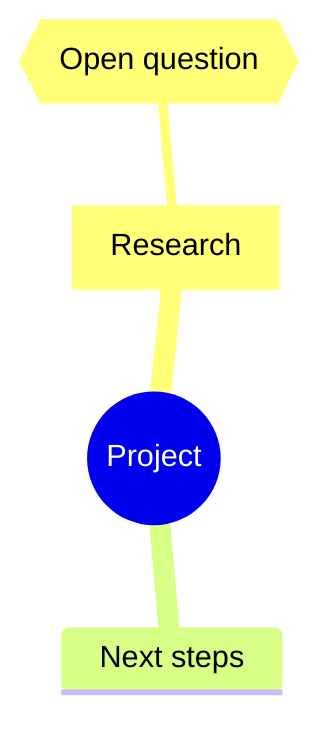

# Mind Map Builder

Mind Map Builder turns the Obsidian Excalidraw canvas into a keyboard-driven brainstorming environment. Add children and siblings, arrange branches, pin nodes, fold subtrees, customize colors and grouping, and copy or paste Markdown outlines. Controls live in a persistent sidepanel and can be undocked into a floating input.

To reuse a branch with its links, images, and grouped notes, select the complete branch on the canvas and use native Excalidraw copy. Select a destination Mindmap node, then use the existing Builder **Paste** button or hotkey. The branch attaches as a child; with no destination selected, it becomes an independent map. Builder **Copy** continues to export Markdown outlines.

Pasted branches retain their styles, folds, pinned nodes, and nested submap settings. Copied whole maps become submaps when attached. Auto-layout remains disabled where you disabled it. Builder's input Undo/Redo groups a completed branch paste; the canvas Undo/Redo controls follow native paste, attachment, and layout history steps.

Builder **Paste** also accepts Mermaid mindmaps, either as plain text starting with `mindmap` or inside a `mermaid` code block. With a node selected, the imported root becomes its child; otherwise it creates a new map. For example:

Supported shape labels are `[rectangle]`, `(ellipse)` / `((ellipse))`, and `{diamond}` / `{{diamond}}`, with optional node IDs. Ordinary Markdown paste keeps `[[wiki links]]` and `[alias](link)` intact. Within Mermaid, standalone links also remain links; `[text]` denotes a rectangle. Unshaped nodes follow Builder's current box settings. Comments and standalone icon/class annotations are ignored; Mermaid styling, configuration blocks, and multiline Markdown strings are outside this limited import format. Use ` ` for label line breaks.

Select a node and use **Copy as Mermaid** in the sidepanel to copy its branch as a fenced Mermaid code block, including folded children and nested submaps. The floating toolbar and **Alt/Option+C** keep their existing Markdown copy behavior. Export includes hierarchy, labels, and supported node shapes; crosslinks, arrow labels, boundaries, and layout settings are omitted. Images and embeds are represented by their text references. Ellipses export as Mermaid circles `((text))`, and diamonds as Mermaid hexagons `{{text}}`, since Mermaid mindmaps have no diamond shape.

> [!Tip]
> Become a MindMap Builder Pro with the official [MindMap Builder course](https://www.visual-thinking-workshop.com/mindmap)!

Requires Excalidraw 2.23.4 or newer. Excalidraw 2.27.0 or newer caches compiled scripts, so repeated hotkey activation reuses compiled code and the existing sidepanel without rereading the script. This script is distributed as readable JavaScript, with no compressed executable payload.

[Modular source and authoring instructions](https://github.com/zsviczian/ea-scripts/tree/main/src/scripts/mindmap-builder) · [API documentation](https://github.com/zsviczian/obsidian-excalidraw-plugin/blob/master/docs/ea-script-docs/MindMapBuilderAPI.md)

If you find MindMap Builder helpful, [buy me a coffee](https://ko-fi.com/zsolt).
